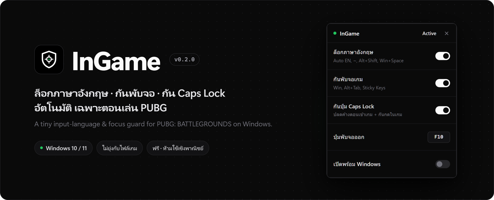

<div align="center">



<br>
<br>

[](https://github.com/eatsbricks/InGame/releases/latest)
[](https://github.com/eatsbricks/InGame/releases)
[](#requirements)
[](https://tauri.app)
[](LICENSE)

[ภาษาไทย](README.md) · **English**

[Download](#download) · [Features](#features) · [Usage](#usage) · [Safety](#safety) · [FAQ](#faq) · [Developers](#developers)

</div>

---

**InGame** is a tiny Windows tray app that only does anything **while the PUBG window is in front**. Switch away and everything goes back to normal instantly.

Sound familiar?

- You hit a key in game and your keyboard is still in **another language**.
- A stray **`Win`** or **`Alt+Tab`** minimizes the game mid-fight.
- Tapping **`Shift`** pops up the **Sticky Keys** dialog over your game.
- **`Caps Lock`** was left on and your keybinds act strangely.

InGame fixes all of this automatically. Leave it running and play.

<a id="features"></a>

## ✨ Features

### 🔤 English lock

Switches to an English keyboard the moment you enter the game, whatever language or IME you had before, and **restores it** when you leave. Also blocks `Win+Space`, plus `~` on PCs where `~` is set as the language hotkey.

### 🪟 Anti-minimize

Blocks left/right `Win`, `Alt+Tab`, `Alt+Esc` and `Ctrl+Esc` while you play. Temporarily disables the Sticky Keys, Toggle Keys and Filter Keys shortcuts and restores them on exit.

### 🔠 Caps Lock guard

Turns off a stuck Caps Lock when you enter the game and blocks it while you play. Works normally again outside the game.

### ⏏️ Escape key `F10`

One press leaves the game for your previous window and lifts every block. Click back into the game and protection resumes. Rebindable.

### 🪶 Lightweight

Hides to the tray and closes its window to free memory. Nothing runs in game until PUBG is open. The installer is only about 2 MB.

> [!TIP]
> `Alt` and `Shift` still work in game for free look, sprint and hold breath. If the language flips by accident, InGame switches it back to English right away.

<a id="download"></a>

## 📥 Download

Grab a file from the **[latest release](https://github.com/eatsbricks/InGame/releases/latest)**.

| File | Best for |
| --- | --- |
| **`InGame-Setup-x.y.z.exe`** | ✅ **Recommended.** Standard installer with a Start Menu shortcut and uninstaller. No admin rights needed. |
| `InGame-x.y.z-portable.exe` | Portable. Double-click to run, nothing to install. |

<a id="requirements"></a>

### 💻 Requirements

- Windows 10 version 1903 or later, or Windows 11 (64-bit)
- An **English** keyboard layout installed in Windows
- [Microsoft Edge WebView2](https://developer.microsoft.com/microsoft-edge/webview2/). Windows 11 ships with it and the installer handles it for you. The portable build on older Windows 10 may need it installed separately.

<details>
<summary><b>Windows shows "Windows protected your PC"</b></summary>

<br>

This is normal for free apps without a paid code-signing certificate. Click **More info**, then **Run anyway**. You only need to do this once.

To check the file has not been tampered with, compare its SHA-256 with the one on the release page:

```powershell
Get-FileHash .\InGame-Setup-0.2.0.exe -Algorithm SHA256
```

</details>

<a id="usage"></a>

## 🎮 Usage

1. **Start InGame.** A shield icon appears in the system tray.
2. **Launch PUBG** as usual. Protection starts on its own.
3. **Need to step out?** Press `F10`, then click back into the game when ready.

That's it. Turn on **Launch with Windows** to have it start automatically.

### Status

| Status | Window | Tray icon | Meaning |
| --- | --- | --- | --- |
| **Active** | 🟢 Green dot | Shield with green dot | Protecting the game |
| **Standby** | ⚫ Gray dot | Plain shield | Waiting for PUBG |
| **Paused** | ⚪ Hollow dot | Crossed-out shield | Protection paused |

Click the status label in the top-right corner to pause or resume.

### Settings

- **Change the escape key.** Click `F10` and press a new key. Supports `F1`–`F12`, `Pause`, `ScrollLock`, `Insert`, `Home`, `End`, `PageUp`, `PageDown` and combos with `Ctrl` / `Alt` / `Shift`. Press `Esc` to cancel.
- **Tray menu.** Left-click opens settings. Right-click to pause or quit.
- **The `×` button** hides to the tray rather than quitting.
- Settings are stored in `%LOCALAPPDATA%\InGame\settings.json`.

> [!NOTE]
> The interface is currently in Thai. The labels from top to bottom are: English lock, Anti-minimize, Caps Lock guard, Escape key and Launch with Windows.

<a id="safety"></a>

## 🛡️ Is it safe with anti-cheat?

InGame is designed to **never touch the game itself**. It works at the Windows level, like any keyboard utility.

| ✅ What it does | ❌ What it never does |
| --- | --- |
| Checks which window is in front using standard Windows APIs | Inject DLLs into the game |
| Installs a system keyboard hook **only while in game**, removed the moment you switch away | Open the game process (`OpenProcess`) or read/write its memory |
| Switches language through the Windows Text Services Framework | Run macros, press keys for you or assist aiming |
| Sends **one** key press to turn off a stuck Caps Lock when entering the game | Modify game files |

To make InGame send **no input at all**, turn off **Caps Lock guard**.

> [!WARNING]
> No one but the game's developer can say how its anti-cheat treats third-party software. **Use at your own risk.**

### 🔒 Privacy

InGame **never connects to the internet**, collects no telemetry and does not log your keystrokes. The only thing it writes to disk is its settings file.

<a id="faq"></a>

## ❓ FAQ

<details>
<summary><b>"PUBG is running as Admin — some keys may not be blocked"</b></summary>

<br>

Steam or PUBG is set to *Run as administrator*, so Windows stops normal apps from handling that window's keys or language.

**Fix:** right-click Steam and `TslGame.exe`, open Properties → Compatibility, untick *Run this program as an administrator*, then relaunch the game.

</details>

<details>
<summary><b>"No English keyboard found in Windows"</b></summary>

<br>

Add **English (United States)** under Settings → Time & language → Language & region, then restart InGame.

</details>

<details>
<summary><b>I use Caps Lock as a keybind in game</b></summary>

<br>

Turn off **Caps Lock guard**. Everything else keeps working.

</details>

<details>
<summary><b>I want to use Windows during a match without minimizing</b></summary>

<br>

Click the status label to switch to **Paused**, or right-click the tray icon and choose pause.

</details>

<details>
<summary><b>How do I uninstall?</b></summary>

<br>

Turn off **Launch with Windows** first if you enabled it, then uninstall from Settings → Apps → Installed apps → InGame. To remove your settings too, delete `%LOCALAPPDATA%\InGame`.

</details>

Found a bug or have an idea? [Open an issue](https://github.com/eatsbricks/InGame/issues/new/choose).

<a id="developers"></a>

## 🧑‍💻 Developers

<details>
<summary><b>Build from source</b></summary>

<br>

**Requires** Windows 10/11, [Node.js](https://nodejs.org) 22.18+ and [Rust](https://rustup.rs) 1.89+ (MSVC toolchain).

```powershell
npm install

# Run in development mode
npm run tauri dev

# Test
npm test
cargo test --manifest-path src-tauri/Cargo.toml
cargo clippy --manifest-path src-tauri/Cargo.toml --all-targets -- -D warnings

# Build release binaries
npm run tauri build
```

The portable exe lands in `src-tauri/target/release/ingame.exe` and the installer in `src-tauri/target/release/bundle/nsis/`.

</details>

See [CHANGELOG.md](CHANGELOG.md) for release history.

## 📄 License

InGame is **free, source-available software** under the **[PolyForm Noncommercial License 1.0.0](LICENSE)**. It is **not** open source.

| ✅ You may | ❌ You may not |
| --- | --- |
| Use it for free for personal use | **Sell** the app or its code |
| Share it with friends, along with the license and copyright notice | Make money from it in any form |
| Study or modify the code for noncommercial purposes | Bundle it into commercial products or services |

This table is a plain-language summary. The [LICENSE](LICENSE) file is what legally applies.

## ⚠️ Disclaimer

InGame is a personal project and is **not affiliated with, endorsed by or sponsored by** KRAFTON, Inc. or PUBG Studios. PUBG and PUBG: BATTLEGROUNDS are trademarks of their respective owners. The software is provided "as is", without warranty of any kind.

<div align="center">

<br>

If InGame makes your games smoother, a ⭐ would mean a lot.

<sub>Made with ♥ in Thailand</sub>

</div>
