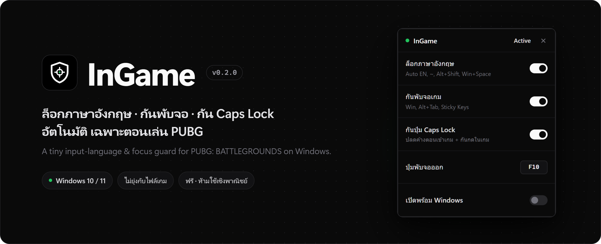

<div align="center">



<br>
<br>

[](https://github.com/eatsbricks/InGame/releases/latest)
[](https://github.com/eatsbricks/InGame/releases)
[](#requirements)
[](https://tauri.app)
[](LICENSE)

**ภาษาไทย** · [English](README.en.md)

[ดาวน์โหลด](#download) · [ฟีเจอร์](#features) · [วิธีใช้](#usage) · [ความปลอดภัย](#safety) · [คำถามที่พบบ่อย](#faq) · [สำหรับนักพัฒนา](#developers)

</div>

---

**InGame** คือโปรแกรมเล็ก ๆ บน Windows ที่ทำงานเงียบ ๆ อยู่ใน System Tray และจะเริ่มทำงาน **เฉพาะตอนหน้าต่าง PUBG อยู่ด้านหน้า** เท่านั้น พอพับจอออกมา ทุกอย่างกลับเป็นปกติทันที

เคยเจอแบบนี้ไหม

- กำลังจะพิมพ์แชทหรือกดปุ่มในเกม แต่ภาษาดันเป็น **ภาษาไทย** อยู่
- เผลอโดนปุ่ม **`Win`** หรือ **`Alt+Tab`** แล้วเกมพับจอกลางไฟต์
- กด **`Shift`** รัว ๆ จน Windows เด้งหน้าต่าง **Sticky Keys** ขึ้นมาบังจอ
- **`Caps Lock`** เปิดค้างอยู่ ทำให้ปุ่มลัดในเกมเพี้ยน

InGame แก้ทั้งหมดนี้ให้อัตโนมัติ ไม่ต้องตั้งค่าอะไรเพิ่ม เปิดทิ้งไว้แล้วเข้าเกมได้เลย

<a id="features"></a>

## ✨ ทำอะไรได้บ้าง

### 🔤 ล็อกภาษาอังกฤษ

สลับเป็นแป้นพิมพ์ภาษาอังกฤษทันทีที่เข้าเกม ไม่ว่าก่อนหน้าจะใช้ภาษาไทย ญี่ปุ่น เกาหลี จีน หรือ IME ไหนอยู่ และ **คืนภาษาเดิมให้** เมื่อพับจอออก พร้อมบล็อก `Win+Space` และปุ่ม `~` (เฉพาะเครื่องที่ตั้ง `~` เป็นปุ่มสลับภาษา)

### 🪟 กันพับจอเกม

บล็อก `Win` ซ้าย/ขวา, `Alt+Tab`, `Alt+Esc` และ `Ctrl+Esc` ระหว่างเล่น และปิดปุ่มลัด Sticky Keys, Toggle Keys, Filter Keys ชั่วคราว แล้วคืนค่าเดิมเมื่อออกจากเกม

### 🔠 กันปุ่ม Caps Lock

ปิด Caps Lock ที่ค้างอยู่ให้ตอนเข้าเกม และกันไม่ให้กดติดระหว่างเล่น ออกจากเกมแล้วใช้ได้ตามปกติ

### ⏏️ ปุ่มพับจอออก `F10`

กดครั้งเดียวเพื่อออกจากเกมไปหน้าต่างก่อนหน้า พร้อมปลดล็อกทุกอย่าง คลิกกลับเข้าเกมเมื่อไหร่ก็ป้องกันต่อให้อัตโนมัติ เปลี่ยนเป็นปุ่มอื่นได้

### 🪶 เบาและไม่กวนเครื่อง

ซ่อนลง Tray แล้วปิดหน้าต่างทิ้งเพื่อคืน RAM ไม่มีอะไรทำงานในเกมจนกว่าจะเปิด PUBG ตัวติดตั้งขนาดแค่ประมาณ 2 MB

> [!TIP]
> ปุ่ม `Alt` และ `Shift` ยังใช้ในเกมได้ตามปกติ (Free Look, วิ่ง, กลั้นหายใจ) ถ้าภาษาถูกสลับโดยบังเอิญ โปรแกรมจะดึงกลับเป็นภาษาอังกฤษให้ทันที

<a id="download"></a>

## 📥 ดาวน์โหลด

ไปที่หน้า **[Releases ล่าสุด](https://github.com/eatsbricks/InGame/releases/latest)** แล้วเลือกไฟล์ที่ต้องการ

| ไฟล์ | เหมาะกับ |
| --- | --- |
| **`InGame-Setup-x.y.z.exe`** | ✅ **แนะนำ** ตัวติดตั้งปกติ มีทางลัดใน Start Menu ถอนการติดตั้งได้จาก Settings ไม่ต้องใช้สิทธิ์ Admin |
| `InGame-x.y.z-portable.exe` | แบบพกพา ดับเบิลคลิกใช้ได้เลยไม่ต้องติดตั้ง เหมาะส่งให้เพื่อนลองใช้ |

<a id="requirements"></a>

### 💻 ความต้องการของระบบ

- Windows 10 เวอร์ชัน 1903 ขึ้นไป หรือ Windows 11 (64-bit)
- มีแป้นพิมพ์ **English** ติดตั้งอยู่ใน Windows
- [Microsoft Edge WebView2](https://developer.microsoft.com/microsoft-edge/webview2/) (Windows 11 มีอยู่แล้ว ตัวติดตั้งจะจัดการให้เอง ส่วนแบบพกพาบน Windows 10 รุ่นเก่าอาจต้องติดตั้งเพิ่ม)

<details>
<summary><b>ขึ้นหน้าจอสีน้ำเงิน "Windows protected your PC" ต้องทำยังไง</b></summary>

<br>

เป็นเรื่องปกติของโปรแกรมแจกฟรีที่ไม่ได้ซื้อใบรับรอง Code Signing ให้คลิก **More info** แล้วกด **Run anyway** ต้องทำแค่ครั้งแรกครั้งเดียว

ถ้าอยากตรวจว่าไฟล์ไม่ถูกแก้ไข ให้เทียบค่า SHA-256 กับที่ระบุไว้ในหน้า Release

```powershell
Get-FileHash .\InGame-Setup-0.2.0.exe -Algorithm SHA256
```

</details>

<a id="usage"></a>

## 🎮 วิธีใช้

1. **เปิด InGame** ไอคอนรูปโล่จะไปอยู่ที่ System Tray มุมขวาล่าง
2. **เข้าเกม PUBG** ตามปกติ โปรแกรมจะเริ่มป้องกันให้เองโดยอัตโนมัติ
3. **อยากออกจากเกมชั่วคราว** กด `F10` แล้วคลิกกลับเข้าเกมเมื่อพร้อม

แค่นั้นเลย ถ้าอยากให้เปิดเองทุกครั้งที่เปิดเครื่อง ให้เปิดสวิตช์ **เปิดพร้อม Windows**

### สถานะของโปรแกรม

| สถานะ | ในหน้าต่าง | ไอคอน Tray | ความหมาย |
| --- | --- | --- | --- |
| **Active** | 🟢 จุดสีเขียว | โล่มีจุดเขียว | กำลังป้องกันเกมอยู่ |
| **Standby** | ⚫ จุดสีเทา | โล่ปกติ | รอให้เปิดหรือสลับเข้าเกม |
| **Paused** | ⚪ วงกลมโปร่ง | โล่ขีดฆ่า | พักการป้องกันชั่วคราว |

คลิกที่ป้ายสถานะมุมขวาบนของหน้าต่างเพื่อพักหรือเปิดการป้องกันต่อได้ทันที

### ปรับแต่ง

- **เปลี่ยนปุ่มพับจอออก** คลิกที่ปุ่ม `F10` แล้วกดปุ่มใหม่ รองรับ `F1`–`F12`, `Pause`, `ScrollLock`, `Insert`, `Home`, `End`, `PageUp`, `PageDown` หรือคีย์ผสมกับ `Ctrl` / `Alt` / `Shift` กด `Esc` เพื่อยกเลิก
- **เมนู Tray** คลิกซ้ายเพื่อเปิดหน้าต่างตั้งค่า คลิกขวาเพื่อพักการป้องกันหรือปิดโปรแกรม
- **ปุ่ม `×`** ไม่ได้ปิดโปรแกรม แต่ซ่อนลง Tray และคืน RAM ของหน้าต่างทิ้ง
- การตั้งค่าเก็บไว้ที่ `%LOCALAPPDATA%\InGame\settings.json`

<a id="safety"></a>

## 🛡️ ปลอดภัยกับระบบ Anti-Cheat ไหม

InGame ออกแบบมาให้ **ไม่แตะตัวเกมเลย** ทำงานแค่ในระดับ Windows เหมือนโปรแกรมตั้งค่าคีย์บอร์ดทั่วไป

| ✅ สิ่งที่ทำ | ❌ สิ่งที่ไม่ทำ |
| --- | --- |
| ดูว่าหน้าต่างไหนอยู่ด้านหน้า ผ่าน API มาตรฐานของ Windows | ไม่ฉีด DLL เข้าเกม |
| ติดตั้ง Keyboard Hook ระดับระบบ **เฉพาะตอนอยู่ในเกม** และถอดออกทันทีเมื่อพับจอ | ไม่เปิดโปรเซสเกม (`OpenProcess`) ไม่อ่านหรือเขียนหน่วยความจำเกม |
| สลับภาษาผ่าน Text Services Framework ของ Windows | ไม่มีมาโคร ไม่กดปุ่มแทนผู้เล่น ไม่ช่วยเล็ง |
| ปิด Caps Lock ที่ค้างอยู่ด้วยการส่งปุ่มเพียง **1 ครั้ง** ตอนเข้าเกม | ไม่แก้ไขไฟล์เกม |

ถ้าต้องการให้โปรแกรม **ไม่ส่งปุ่มใด ๆ เลย** ให้ปิดสวิตช์ **กันปุ่ม Caps Lock**

> [!WARNING]
> แม้จะออกแบบอย่างระมัดระวัง แต่ไม่มีใครรับประกันแทนผู้พัฒนาเกมได้ว่าระบบ Anti-Cheat จะมองโปรแกรมภายนอกอย่างไร **ใช้งานด้วยความรับผิดชอบของคุณเอง**

### 🔒 ความเป็นส่วนตัว

InGame **ไม่เชื่อมต่ออินเทอร์เน็ต** ไม่เก็บสถิติการใช้งาน และไม่บันทึกปุ่มที่คุณกด ข้อมูลเดียวที่เขียนลงเครื่องคือไฟล์การตั้งค่า

<a id="faq"></a>

## ❓ คำถามที่พบบ่อย

<details>
<summary><b>ขึ้นข้อความ "PUBG รันสิทธิ์ Admin — บางปุ่มอาจไม่ถูกบล็อก"</b></summary>

<br>

Steam หรือ PUBG ถูกตั้งให้รันแบบ *Run as administrator* ทำให้ Windows ไม่ยอมให้โปรแกรมสิทธิ์ปกติจัดการปุ่มหรือภาษาของหน้าต่างนั้น

**วิธีแก้:** คลิกขวาที่ Steam และ `TslGame.exe` เลือก Properties → Compatibility แล้วเอาเครื่องหมายถูกที่ *Run this program as an administrator* ออก จากนั้นเปิดเกมใหม่

</details>

<details>
<summary><b>ขึ้นข้อความ "ไม่พบแป้นพิมพ์ภาษาอังกฤษใน Windows"</b></summary>

<br>

เพิ่มแป้นพิมพ์ **English (United States)** ที่ Settings → Time & language → Language & region แล้วเปิดโปรแกรมใหม่

</details>

<details>
<summary><b>ผมผูกปุ่ม Caps Lock ไว้ใช้ในเกม</b></summary>

<br>

ปิดสวิตช์ **กันปุ่ม Caps Lock** ในหน้าต่างตั้งค่า ฟีเจอร์อื่นยังทำงานตามปกติ

</details>

<details>
<summary><b>อยากใช้ Windows ระหว่างเกมโดยไม่ต้องพับจอ</b></summary>

<br>

คลิกป้ายสถานะเพื่อเปลี่ยนเป็น **Paused** หรือคลิกขวาที่ไอคอน Tray แล้วเลือก **พักการป้องกันชั่วคราว**

</details>

<details>
<summary><b>ถอนการติดตั้งยังไง</b></summary>

<br>

ถ้าเปิด **เปิดพร้อม Windows** ไว้ ให้ปิดสวิตช์ก่อน แล้วถอนการติดตั้งจาก Settings → Apps → Installed apps → InGame ถ้าต้องการลบการตั้งค่าด้วย ให้ลบโฟลเดอร์ `%LOCALAPPDATA%\InGame`

</details>

ไม่เจอคำตอบ หรือเจอบั๊ก? [เปิด Issue ได้เลย](https://github.com/eatsbricks/InGame/issues/new/choose)

<a id="developers"></a>

## 🧑‍💻 สำหรับนักพัฒนา

<details>
<summary><b>Build จากซอร์สโค้ด</b></summary>

<br>

**ต้องมี:** Windows 10/11, [Node.js](https://nodejs.org) 22.18+ และ [Rust](https://rustup.rs) 1.89+ (MSVC toolchain)

```powershell
# ติดตั้ง dependencies
npm install

# รันแบบพัฒนา (hot reload)
npm run tauri dev

# ทดสอบ
npm test
cargo test --manifest-path src-tauri/Cargo.toml
cargo clippy --manifest-path src-tauri/Cargo.toml --all-targets -- -D warnings

# สร้างไฟล์ Release
npm run tauri build
```

ไฟล์แบบพกพาจะอยู่ที่ `src-tauri/target/release/ingame.exe` และตัวติดตั้งอยู่ที่ `src-tauri/target/release/bundle/nsis/`

</details>

<details>
<summary><b>โครงสร้างโปรเจกต์</b></summary>

<br>

```text
InGame/
├── index.html, src/          # หน้าต่างตั้งค่า (TypeScript + Vite)
│   └── rebind.ts             # ตรวจและแปลงปุ่มพับจอออก
└── src-tauri/src/            # แกนหลัก (Rust + Tauri 2)
    ├── config.rs             # อ่าน/เขียนการตั้งค่า
    ├── state.rs              # สถานะ Standby / Active / Paused
    ├── key_filter.rs         # กติกาว่าปุ่มไหนต้องบล็อก
    └── win32/
        ├── detector.rs       # ตรวจจับหน้าต่าง PUBG
        ├── hook.rs           # Keyboard hook
        ├── language.rs       # สลับและคืนภาษา (TSF)
        ├── capslock.rs       # กันปุ่ม Caps Lock
        ├── accessibility.rs  # Sticky / Toggle / Filter Keys
        ├── minimizer.rs      # ปุ่มพับจอออก
        ├── startup.rs        # เปิดพร้อม Windows
        └── coordinator.rs    # ประสานทุกส่วนเข้าด้วยกัน
```

</details>

ดูรายการเปลี่ยนแปลงทั้งหมดได้ที่ [CHANGELOG.md](CHANGELOG.md)

## 📄 License

InGame เป็นซอฟต์แวร์ **แจกฟรี** ที่เปิดให้ดูซอร์สโค้ดได้ (source-available) ภายใต้ **[PolyForm Noncommercial 1.0.0](LICENSE)** ซึ่ง **ไม่ใช่** Open Source

| ✅ ทำได้ | ❌ ห้ามทำ |
| --- | --- |
| ใช้งานส่วนตัวฟรี | **ขาย** ไม่ว่าจะเป็นตัวโปรแกรมหรือโค้ด |
| แจกต่อให้เพื่อน โดยแนบไฟล์ License และข้อความลิขสิทธิ์ไปด้วย | นำไปใช้หารายได้ในรูปแบบใด ๆ |
| ศึกษาหรือแก้ไขโค้ดเพื่อใช้แบบไม่แสวงหากำไร | นำไปรวมในสินค้าหรือบริการเชิงพาณิชย์ |

ข้อความในตารางเป็นเพียงสรุปให้อ่านง่าย เงื่อนไขที่มีผลทางกฎหมายคือไฟล์ [LICENSE](LICENSE)

## ⚠️ ข้อจำกัดความรับผิดชอบ

InGame เป็นโปรเจกต์ส่วนตัวที่ **ไม่มีส่วนเกี่ยวข้อง ไม่ได้รับการรับรอง และไม่ได้รับการสนับสนุน** จาก KRAFTON, Inc. หรือ PUBG Studios ชื่อ PUBG และ PUBG: BATTLEGROUNDS เป็นเครื่องหมายการค้าของเจ้าของที่เกี่ยวข้อง ซอฟต์แวร์นี้ให้มา "ตามสภาพ" โดยไม่มีการรับประกันใด ๆ

<div align="center">

<br>

ถ้าโปรแกรมนี้ช่วยให้เล่นสนุกขึ้น ฝากกด ⭐ ให้ด้วยนะครับ

<sub>Made with ♥ in Thailand</sub>

</div>
